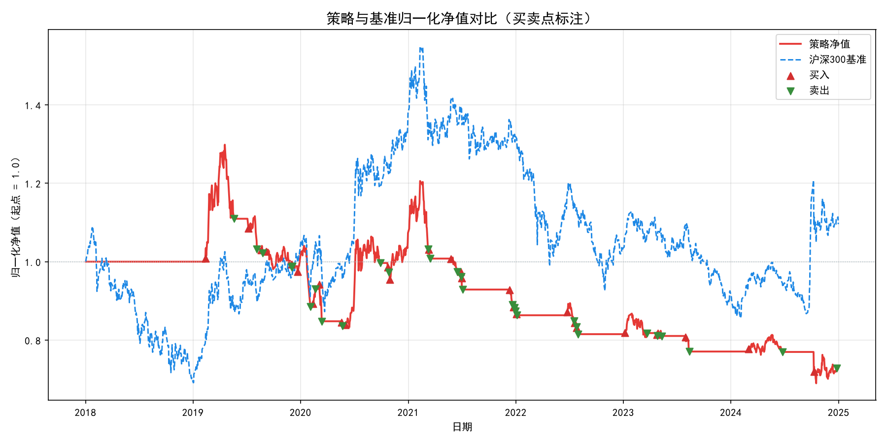

# 沪深300ETF 双均线择时量化交易系统

> 基于 DMA-TF（双均线趋势择时 + 长期趋势过滤）策略，对沪深300ETF（510300）进行历史回测，
> 与"买入并持有"基准做横向对比。课程分组项目，5 人协作完成。

## 一、项目简介

本项目是一个基于历史日频数据的量化投资/交易系统，采用模块化架构，包含五个部分：
数据接入 → 策略信号 → 回测引擎 → 结果分析 → 展示输出。
策略为 DMA-TF 双均线择时（MA20/MA60/MA120），信号滞后一日执行以杜绝未来函数；
回测引擎逐日盯市，含佣金、印花税与滑点。系统可一条命令复现运行。

## 二、目录结构

```
quant_project/
├── main.py                 # 日常展示入口：读取已生成结果，秒出
├── rebuild_from_raw.py     # 全链路复现入口：从原始行情一键重跑（答辩演示用）
├── 一键运行_日常展示.bat    # Windows 双击运行（推荐）
├── 一键运行_全链路复现.bat  # Windows 双击运行（答辩演示）
├── requirements.txt        # 依赖清单
├── data/
│   ├── raw/                # akshare 下载的原始行情
│   │   └── etf_510300_data.csv
│   └── processed/          # 回测结果数据
│       ├── equity_curve.csv    # 净值曲线（策略 + 基准）
│       └── trade_log.csv       # 成交流水（58 笔）
├── src/
│   ├── data_collection/    # 数据获取与处理（组员2）
│   │   ├── __init__.py
│   │   └── fetch_etf.py        # akshare 下载 510300 → 清洗 → 落盘
│   ├── data.py             # 回测结果加载（组员5 整合）
│   ├── strategy.py         # DMA-TF 策略信号（组员1）
│   ├── backtest.py         # 事件驱动回测引擎（组员3）
│   ├── analysis.py         # 指标计算（组员4）
│   └── display.py          # 展示与出图（组员5）
├── teammate_files/         # 组员原始交付文件备份
├── outputs/                # 运行结果：指标表 + 净值图
│   ├── 指标对照表.csv
│   ├── 净值对比图.png
│   └── 净值对比图_全链路复现.png
└── README.md
```

## 三、数据来源

策略回测数据通过 **akshare（东方财富）** 免费接口 `fund_etf_hist_em` 获取，
标的为**沪深300ETF（510300）**前复权日线，区间 2018 年 1 月至 2024 年末（1699 个交易日）。
数据接入脚本 `src/data_collection/fetch_etf.py`（组员2）完成"下载 → 清洗 → 落盘"全流程，
无需注册或 token。基准设定为"买入并持有沪深300ETF"，与策略在同一标的、同一区间对比，保证可比性。

## 四、安装与运行

**方式一（推荐，双击即可）**：直接双击项目根目录下的 bat 文件：

- `一键运行_日常展示.bat` —— 读取已生成的回测结果，秒出指标和净值图
- `一键运行_全链路复现.bat` —— 从原始行情重跑完整链路（答辩演示用）

bat 文件内已写死 Python 3.12 的绝对路径，不受系统 PATH 影响。

**方式二（命令行）**：

```bash
pip install -r requirements.txt
python main.py                 # 日常展示：读取已生成结果，秒出
python rebuild_from_raw.py     # 全链路复现：现场下载 → 信号 → 回测 → 指标 → 出图
```

> Windows 注意：如果输入 `python` 没反应、也不报错，说明 `python` 指向了微软商店占位符
> （`AppData\Local\Microsoft\WindowsApps\python.exe`）。请改用双击 bat，
> 或用完整路径 `C:\Users\HUAWEI\AppData\Local\Programs\Python\Python312\python.exe main.py`。

两条命令都会打印指标对照表并在 `outputs/` 生成图表。其中 `rebuild_from_raw.py`
从原始行情完整重跑（本地已有 `data/raw/etf_510300_data.csv` 时直接读取，
缺失时自动从 akshare 下载，断网/限流也能演示），产出的四项指标与已存结果**完全一致**，
是"系统拥有真实可运行内核（非静态展示页）"的直接证据——答辩时建议演示这一条。

输出文件：
- `指标对照表.csv`（累计收益、年化收益、最大回撤、夏普比率）
- `净值对比图.png`（策略 vs 基准归一化净值，标注买卖点）
- `净值对比图_全链路复现.png`（从原始行情重跑得到的曲线）

## 五、输出示例

```
========================================================================
  回测指标对照表
========================================================================
对象   累计收益率  年化收益率    最大回撤    夏普比率
策略 -27.17% -4.43% -46.88% -0.4030
基准   9.57%  1.31% -44.75%  0.0848
========================================================================
```



> 说明：当前版本策略未跑赢基准，报告"回测结果与分析"章节已做客观归因，
> 并给出信号逻辑、止盈止损、参数寻优等后续优化方向。

## 六、组员分工

| 组员 | 负责模块 | 交付物 |
| --- | --- | --- |
| 组员1 | 量化策略设计 | 策略设计文档、DMA-TF 信号代码 |
| 组员2 | 数据获取与处理 | akshare 沪深300ETF 历史数据集、下载与清洗代码（`src/data_collection/fetch_etf.py`） |
| 组员3 | 回测引擎开发 | 事件驱动回测引擎、回测结果数据 |
| 组员4 | 回测结果分析 | 指标表、净值曲线、结果分析 |
| 组员5 | 系统展示与工程实现 | 展示模块、README、GitHub 仓库、报告与 PPT |

## 七、AI 辅助说明

本项目在开发过程中使用 AI 编程助手（WorkBuddy）辅助搭建工程骨架、整合各模块代码、
调试运行环境与生成可视化图表。策略逻辑与指标口径来自组员设计与讨论，
全体组员均已理解策略原理并能独立完成答辩。
